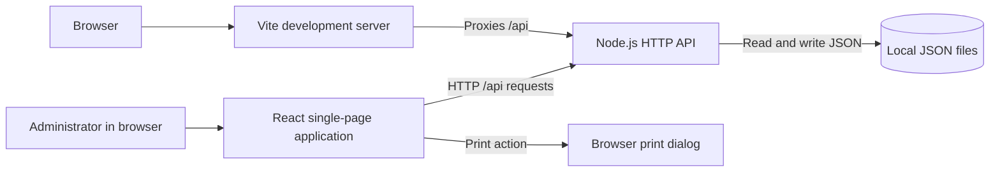

# Toleti-e System Design

## 1. Business Objective

Toleti-e is a business-document management application for Toleti Enterprises. It brings common sales, purchasing, adjustment, and dispatch paperwork into one web workspace so an administrator can create, review, update, find, print, and remove business records.

The current application focuses on six document types:

- Quotations
- Purchase orders
- Invoices
- Debit notes
- Credit notes
- Delivery challans

Its objective is to reduce manual document preparation and make business records easier to access and maintain. The application provides a browser-based dashboard backed by a small HTTP API and local JSON-file storage.

## 2. Why This Project Exists

Managing business documents in separate files or manual processes can lead to:

- Repeated entry of customer, supplier, and item details
- Difficulty locating a document by its number, contact, or date
- Inconsistent records when documents are edited in multiple places
- Extra effort preparing printable copies of business documents
- Limited visibility into the documents maintained by the business

Toleti-e addresses these needs with a single workspace for document entry and management.

## 3. Users and Problems

### Primary user: Administrator

The implemented interface is organized around an administrator who signs in, opens a document service, and manages the business records available to the application.

### User problems addressed

1. **Scattered document workflows** — The dashboard groups six business document types in one place.
2. **Manual document preparation** — Dedicated forms capture parties, dates, line items, and document-specific charges or tax details.
3. **Difficult record retrieval** — Search spans the document types and supports customer or supplier name, phone, date, and document number.
4. **Keeping records current** — Records can be created, updated, and deleted through the API.
5. **Preparing documents for use** — Document views support browser printing.

## 4. Proposed Solution and Functional Areas

### Dashboard and sign-in

The React application presents a sign-in screen and, after sign-in, a dashboard with navigation for each document service. The dashboard also provides cross-document search and a sign-out action.

### Quotations

Create and manage customer quotations with customer details, dates, line items, and applicable charge/tax information.

### Purchase orders

Create and manage supplier purchase orders, including supplier information, order and delivery dates, line items, and applicable charges.

### Invoices

Create and manage customer invoices with invoice and due dates, line items, and invoice-specific charges and taxes. Amounts are formatted in Indian rupees (INR).

### Debit and credit notes

Maintain adjustment documents linked to customer and transaction details, with document-specific dates and line items.

### Delivery challans

Maintain dispatch documents for goods delivered to customers.

### Cross-document search and print

Search loads records from the document collections and filters them in the browser. Search considers document identifiers, customer or supplier names, phone numbers, and dates. Each document form can prepare a printable browser view.

## 5. System Architecture

### Frontend

- **Technology:** React 19, JavaScript ES modules, and Vite.
- **Entry point:** `src/main.jsx` mounts the application in the browser.
- **Application shell:** `src/App.jsx` manages sign-in state, dashboard navigation, and cross-document search.
- **Document modules:** Separate React components in `src/components/` implement the six document workflows.
- **Presentation:** CSS files in `src/` provide global and application styling.

### API

- **Technology:** Node.js built-in HTTP server; no web framework is listed as a project dependency.
- **Implementation:** `server/index.js`.
- **Development integration:** Vite proxies `/api` requests to `http://127.0.0.1:3001`.
- **Development startup:** `npm run dev` starts the API and Vite together. `npm run dev:api` starts the API by itself.
- **Request handling:** The API parses JSON request bodies, validates document fields, and returns JSON responses with HTTP status codes.

### Persistence

The current implementation uses one JSON file per document type in the project root:

| Document collection | API collection path | Storage file |
|---|---|---|
| Quotations | `/api/quotations` | `quotation.json` |
| Purchase orders | `/api/purchase-orders` | `purchase order.json` |
| Invoices | `/api/invoices` | `Invoice.json` |
| Debit notes | `/api/debit-notes` | `Debit note.json` |
| Credit notes | `/api/credit-notes` | `Credit note.json` |
| Delivery challans | `/api/delivery-challans` | `delivery challance.json` |

This is file-based persistence rather than a database. The API serializes write operations in-process and writes through temporary files before replacing the collection file. This is appropriate for a small, single-instance development or low-volume deployment, but does not provide database transactions, multi-instance coordination, or built-in backup and recovery.

## 6. API and Data Design

Each document type is represented as a collection of JSON records. Records include a generated document identifier, party details, relevant dates, line items, and document-specific fields such as tax rates or charges. A line item generally contains a description, quantity, and unit price, with optional product or classification fields depending on the document type.

The API exposes collection operations for each collection path:

| Method | Path | Purpose |
|---|---|---|
| `GET` | `/api/{collection}` | List records in a document collection |
| `POST` | `/api/{collection}` | Validate and create a record |
| `PUT` | `/api/{collection}/{id}` | Validate and update the identified record |
| `DELETE` | `/api/{collection}/{id}` | Delete the identified record |

`{collection}` is one of the six paths in the table above. The API generates identifiers for newly created records. Validation includes required party/document fields, date formats, line-item constraints, and non-negative numeric amounts where applicable. Request bodies are limited to 1 MB.

## 7. Typical Workflows

### Create a document

1. The administrator signs in and selects a document service.
2. The corresponding React component displays a form.
3. The user enters party, date, item, and document-specific information.
4. The frontend submits JSON to the collection API endpoint.
5. The API validates the request, creates an identifier, and persists the record.
6. The frontend reports the result and refreshes the displayed records.

### Find a document

1. The administrator opens dashboard search.
2. The frontend requests each document collection from the API.
3. The browser filters the returned records by supported search values.
4. Selecting a result opens its document service.

### Update or remove a document

The document component sends a `PUT` or `DELETE` request to the record-specific API path. The API applies the change to its JSON collection and returns the result or a descriptive error.

### Print a document

The browser renders the selected document in a print-oriented view and invokes the browser's print dialog. Printing is client-side; no server-side PDF generation service is currently configured.

## 8. Security and Operational Considerations

The current sign-in flow is a lightweight application gate, not production-grade authentication. The frontend imports credential data and compares it in the browser. The signed-in flag is stored in browser session or local storage, and the API does not enforce user authentication or authorization. Therefore, anyone who can reach the API can potentially access its document operations. Do not treat this implementation as protecting sensitive business data in a publicly reachable deployment.

Before production use with real customer or financial information, the system should use server-validated authentication, enforce authorization on every API operation, store credentials securely outside frontend assets, and deploy behind HTTPS with appropriate network access controls.

Additional operational considerations:

- JSON files should be backed up and protected with appropriate filesystem permissions.
- File-based persistence is tied to the API host's filesystem and does not automatically synchronize between application instances.
- There is no configured database, audit trail, role model, or automated recovery process in the current repository.
- API validation and explicit error responses help reject malformed records, but do not replace access controls or secure deployment.

## 9. Non-Functional Goals

- **Usability:** Keep the primary document workflows accessible from a single dashboard.
- **Consistency:** Use document-specific API validation and shared JSON response conventions.
- **Searchability:** Support retrieval across all six document collections.
- **Print readiness:** Make common business documents printable through the browser.
- **Maintainability:** Keep each document workflow in its own React component and API validation/storage logic in the Node server.
- **Reliability at current scale:** Serialize in-process file writes and surface API errors to the frontend.

These are current implementation characteristics and goals; they do not imply database-level durability, horizontal scaling, or production security guarantees.

## 10. Future Evolution

If usage, data sensitivity, or concurrent access grows, consider:

1. Moving document persistence to a transactional database with migrations and backups.
2. Adding server-side authentication, role-based authorization, and audit logging.
3. Defining shared schemas and API contracts for all document types.
4. Adding automated tests for document validation, API behavior, and financial calculations.
5. Supporting export, PDF generation, and configurable document templates.
6. Adding deployment health checks, structured logging, and monitored backup/restore procedures.

These are possible next steps, not features currently claimed by the application.

## 11. Summary

Toleti-e is a React and Node.js business-document workspace for quotations, purchase orders, invoices, debit notes, credit notes, and delivery challans. Its current design combines a browser-based dashboard, a JSON HTTP API, and local JSON-file persistence. It provides document CRUD workflows, cross-collection search, and browser printing. The design is intentionally small, while its client-side sign-in and file-based storage mean that stronger authentication, authorization, database persistence, and operational safeguards are necessary before scaling or handling sensitive data in production.
